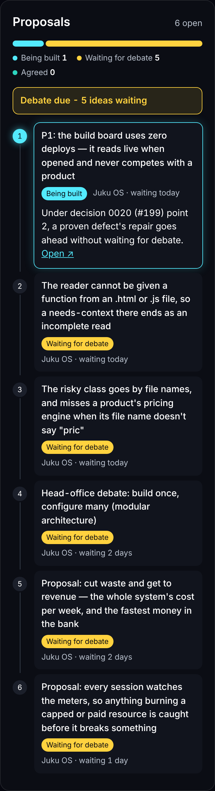

# The Roadmap: the proposals card

Scope: the Roadmap's proposals card. Open when: changing the proposals card, or checking it against what he approved.

**Approved by picture, 17 October 2026** (the card's colours, and the tiles from before-and-after pictures at phone and desktop width). One card above the product timelines, on the Roadmap's live read, so it adds no deploy; built in `board/build.py` (`proposals_card`) and held by its selftest. The picture is the real card at phone width (390 px), this repository's issues only, a product's ideas being private.

**The screen spec.**
- Pure HTML and CSS: no image, no chart library, no script for looks; under 10 KB with its styles (the selftest holds it with ten rows).
- One dark scheme, cohesive, with high-contrast moments: neutral near-black surfaces and neutral ink; the stages blue (being built), amber (waiting for debate) and teal (agreed), one validated dark set (lightness, chroma, colour-blind separation and contrast checked); blue the one accent, on the P1 row, the links and Show more; a stage's colour on its dot and bar alone, never its text. On a wide screen each row's stage and age sit on its title's line when it fits.
- Top: "Proposals" and the open count, then a stage bar sized by count: Being built (blue), Waiting for debate (amber), Agreed (teal), each labelled with its count.
- An amber "Debate due - N ideas waiting" banner when decision 0020's trigger is met (3 proposals waiting, or one waiting 7 days); the rule only behind its tap.
- A numbered spine down the left; the P1 node and card glow blue. Each row: the title, a stage pill and the time waited; a tap opens its one plain sentence.
- Busy: the top 6, the rest under "Show N more". Empty: a grey bar and "Nothing waiting".
- **Closed until tapped.** The card lives inside the Proposals tile, beside the spend tile: the label, the open count, a few words on its state (Debate due, N being built, No debate due, Nothing waiting, or Not read) and the stage bar. A tap opens the card across the row, in place, without repeating the tile's heading, count and bar. The tiles are `glance()` in `board/build.py`.

**What it reads.** This repository's open issues labelled `proposal`, ranked by their `Priority:` line (P1 to P4; none sorts last), then oldest, and each product's `proposed` roadmap items after them. An issue an open pull request here says it builds, closes, fixes, resolves or implements (`#N`) is being built, one it only cites is not; one whose body has a `Decision: agreed` line is agreed; the rest wait for debate, as do the products' ideas. Its sentence is the issue's `Plain:` line, else its priority's reason; a product idea's is its `plain`. Priority and age rank it, not a dependency. It reads the first 100 open proposals.
