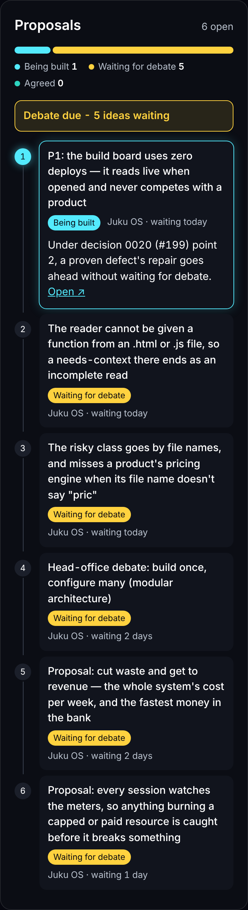

# The Roadmap: the proposals card

Scope: the Roadmap's proposals card. Open when: changing the proposals card, or checking it against what he approved.

**Approved: Option D** (R-2026-10-15aa). One card above the product timelines, on the board's live read, so it adds no deploy. Built in `board/build.py` (`proposals_card`), held by its selftest. The picture below is the real card rendered from the open proposals at phone width (390 px); it shows this repository's issues only, since a product's ideas are private and this repository is public. He approved its colours by looking (R-2026-10-17ac).

**The screen spec.**
- Pure HTML and CSS: no image, no chart library, no script for looks; under 10 KB with its styles (the selftest holds it with ten rows).
- One dark scheme, cohesive, with high-contrast moments, adaptive to phone and desktop (R-2026-10-16aa; approved by looking, R-2026-10-17ac): neutral near-black surfaces and neutral ink; the stages blue (being built), amber (waiting for debate) and teal (agreed), one validated dark set (lightness, chroma, colour-blind separation and contrast checked); blue the one accent, on the P1 row, the links and Show more; a stage's colour on its dot and bar alone, never its text. On a wide screen each row's stage and age sit on its title's line when it fits.
- Top: "Proposals" and the open count, then a stage bar sized by count: Being built (blue), Waiting for debate (amber), Agreed (teal), each labelled with its count.
- An amber "Debate due - N ideas waiting" banner when decision 0020's trigger is met (3 proposals waiting, or one waiting 7 days); the rule only behind its tap.
- A numbered spine down the left; the P1 node and card glow blue. Each row: the title, a stage pill and the time waited; a tap opens its one plain sentence.
- Busy: the top 6, the rest under "Show N more". Empty: a grey bar and "Nothing waiting".

**Closed until tapped** (R-2026-10-17ad): the detail is hidden from the main screen and drilled down to, so the projects show without scrolling past it. The card lives inside the Proposals tile, beside the spend card's tile: the label, the open count, a few words on its state (Debate due, N being built, No debate due, Nothing waiting, or Not read) and the stage bar. A tap opens the card across the row, in place. Inside it, the heading, count and bar the tile already shows are hidden, so the "Top:" bullet above and the picture show the card as it was approved, before it moved into the tile. The tiles are `glance()` in `board/build.py`, pure HTML and CSS. He approved them by looking, from before-and-after pictures at phone and desktop width (R-2026-10-17ae).

**What it reads.** This repository's open issues labelled `proposal`, ranked by their `Priority:` line (P1 to P4; none sorts last), then oldest, and each product's `proposed` roadmap items after them. An issue an open pull request here says it builds, closes, fixes, resolves or implements (`#N`) is being built, one it only cites is not; one whose body has a `Decision: agreed` line is agreed; the rest wait for debate, as do the products' ideas. Its sentence is the issue's `Plain:` line, else its priority's reason; a product idea's is its `plain`. Priority and age rank it, not a dependency. It reads the first 100 open proposals.
