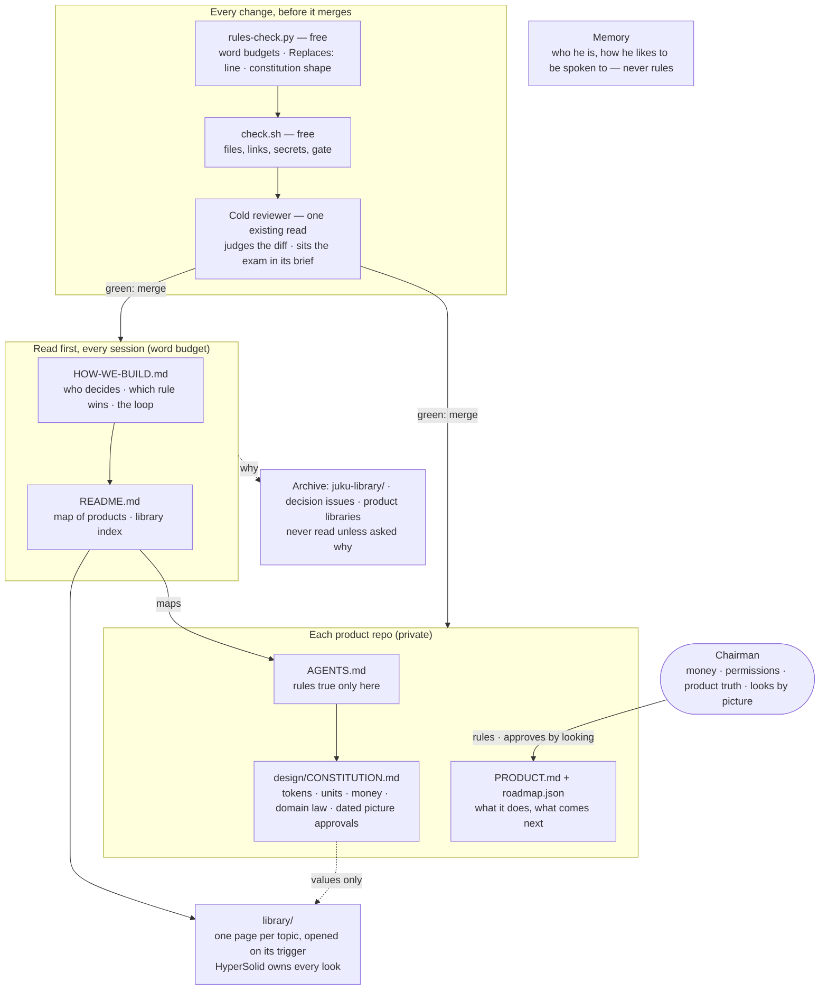

# How Juku OS fits together

Scope: the whole system. Open when: explaining how Juku OS fits together, or finding which part owns what.

One picture of where things live and which check guards them. Each box's own file is the rule.

**Which rule wins** is written once, in `HOW-WE-BUILD.md`. **Who owns which truth**: how we build, this repository; what a product is and does, its own repository; which model does a job, `model-registry/registry.json`; why a rule is what it is, the archive. A Project holds instructions, never a copy of any of these.
