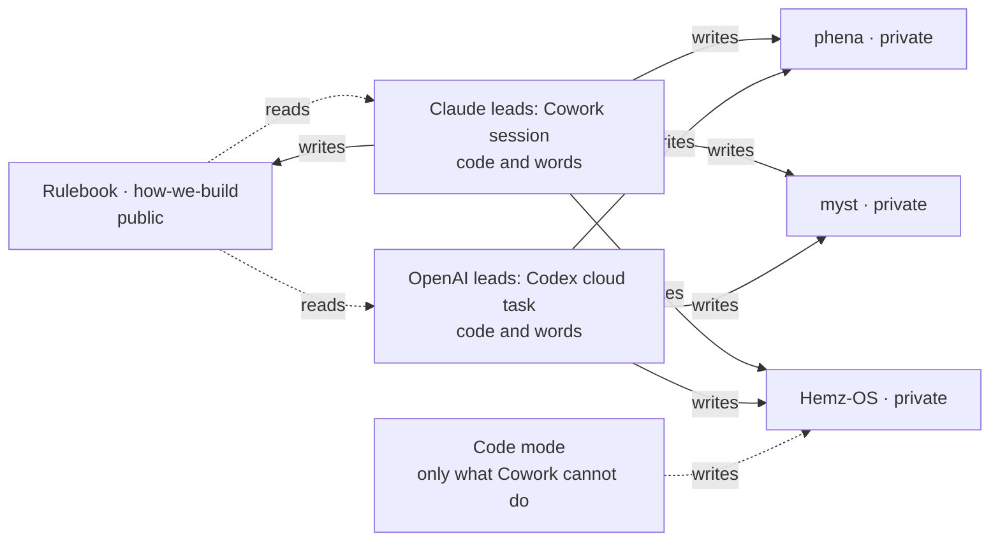

# The two stacks

Scope: every session, a product's or this rulebook's, in either stack. Open when: choosing the lead or its effort, starting, handing over or finishing work in either stack, deciding whether a job needs code mode, or a job that needs hands.

One lead owns a slice at a time. The pull request is the handover, and a replacement lead rebuilds what it needs from GitHub, never from a chat. At a clean checkpoint, *build* in the other stack transfers ownership — and only then: ownership moves when the pull request's latest entry is the outgoing lead's checkpoint. Otherwise the incoming lead leaves that pull request alone and takes the next item. Nothing is built to manage this: no switch file, no lock service, no registry, no orchestrator.

**Cowork first** (R-2026-11-01ba; [#295](https://github.com/Adonis80/how-we-build/pull/295)). When Claude leads, a Cowork session is the workshop for code and words alike: it attaches the repository to itself (the Mac's key is the fallback), builds on a branch, and proves it — the build, the tests, the Playwright journey on phone and desktop, the preview — by the same pull request and review as everything else. Code mode at `claude.ai/code` is used only for a job Cowork cannot do, named with why on the pull request. A successor the standing task fires is neither a Cowork choice nor a code-mode one: it lands wherever the scheduler puts it (`library/session-changeover.md`). Size is not the line; what Cowork can do is. One session reaches one product's repository — one product — reads the rulebook, and writes down:

**A brief to a code session** names passages and the commit, carries patches on the branch rather than inline, and forecasts the files expected (a forecast, not a limit); a mandatory entry document is still read as its rule says. Its shape (decision 0015): a bootstrap, hard rules, tasks each with goal, files, change, acceptance and stop, and a definition of done; a report to the Chairman ends with a receipt: what was read, in KB, and the cost.

**Whichever stack leads, his part is only a tap no hand may make.** The hands may not sign in for him, type a password or a secret into a web page, get past an are-you-human check, pay, or approve a sign-in key on his account by themselves; nor can they send his opener or make the one whole-file edit the platform keeps from every session (`library/his-opener.md`, which says that only a session he opened asks him for either). A session takes such a job to that one tap and hands him the tap alone — the link, what he will see, the words to reply — never the job, and never a choice of how.

**The effort ladder** (R-2026-09-28ba; [#124](https://github.com/Adonis80/how-we-build/pull/124)).
- **Medium** for small, clear fixes.
- **High** is the default for product slices, and the lead runs there.
- **Max** only for knotty work with several interlocking business rules, or a failure diagnosed as a reasoning limit. The lead stays at high and hands that one bounded piece to the product's max subagent, at the model and effort of the registry's `max-subagent` role (library/max-subagent.md). **xhigh** is a middle step where it fits.
- **Never step up just because a check failed.** Diagnose first: a broken setup, missing product truth, a dependency, an oversized slice. Fix the cause or shrink the slice, and step back down once the hard part is done.

**Who leads** (R-2026-09-11bb). While a Claude model is the strongest available to him, it leads, and the OpenAI path stays configured to build; who reviews is the registry's (*The independent reviewer*). The rules are written by role, so the swap costs nothing the day that changes.

**Anthropic.** Building happens in a Cowork session in the product's Project, the product's repository and this rulebook attached (*Session changeover*), or in the cloud session a fired standing task starts, wherever it lands (`library/session-changeover.md`); a chat session advises. The product's `.claude/` files load once its repository is in the session.

**The hard stop binds there too**: its `.claude/settings.json` enforces it where that file is applied, and where that is unproved the session holds it by this rule, never calling a clock tool.

**Its hands are Claude's own, in that same session: the Chrome extension, computer use on the Mac, and the Claude app's built-in browser** — for a console, a dashboard, a setting no pipeline can reach (R-2026-09-14bb, R-2026-09-17ba). Claude's own pages at `claude.ai` go to the built-in browser, since the extension refuses them. A code session started at `claude.ai/code` has none of these hands.

**A job that needs hands, in a code session.** A code session that is used puts the job in CI; where CI cannot do it, it writes the job on its pull request under **Hands needed:** with every choice already made, and tells him only where to take it: a Cowork session in the product's Project, and the word *build* — the only word he types to start work, in either stack and in Cowork or code mode, because the reply names the room and the session works out the job. That session reads the open pull requests for the line, sees whether the job in front of it is hands or code, does the work, and says so on the pull request — what was done, never a secret — so the next session on *build* carries the slice on rather than asking again.

**Such a job keeps an open pull request until it is done** (R-2026-09-19ba), and the slice carrying it does not merge out from under it: either the pull request waits, or the job moves to one that stays open before the merge. Only what is still open moves: the mover first reads that pull request's later comments and the job's own link, and a job marked done, or replaced by a newer note, stays behind as spent (R-2026-10-27ba). Such a job is found only by reading the open pull requests, so an open one left on a merged pull request is a job *build* will never find, which is the same as handing him the job. Neither is a second lead; advising is not owning.

**OpenAI.** Codex is the development surface — cloud by default, local only when the work needs the Mac — and ChatGPT is the advisory surface, reading GitHub and writing only what `library/consultant.md` lets the consultant write. The Chairman's finding of 11 September 2026: the strongest OpenAI model is reachable only from ChatGPT's cloud work mode, and the ChatGPT desktop app cannot work in a repository at all. So an OpenAI-led build runs as a Codex cloud task. A Codex cloud environment is built from the repository's own toolchain, not from a template: the setup script installs what the lockfiles name and clones this rulebook to `~/.juku/how-we-build`; the maintenance script refreshes that clone and fails closed, so a cached environment never starts on stale rules; agent internet stays off unless the repository genuinely needs it, and then as a named allowlist — its package registry and GitHub — restricted to GET, HEAD and OPTIONS, because the broad preset has a published prompt-injection route out; and no secret is added until a product proves it needs one. One line in the product's `AGENTS.md` points a lead working offline at the local rulebook. **It has no hands**: ChatGPT builds nothing and Codex has no browser, so an OpenAI-led slice puts a manual action in CI, and where it cannot, checkpoints and transfers by the route above rather than borrowing another stack's. Nothing reaches the Chairman instead.
